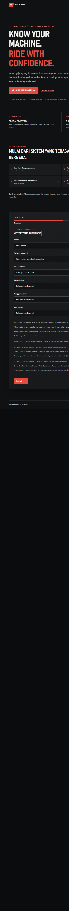
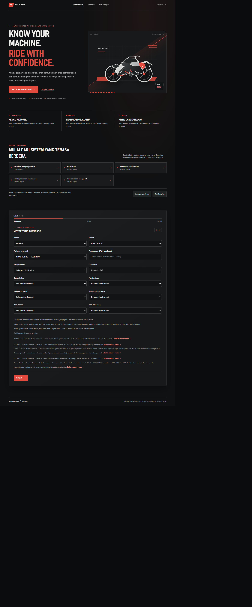
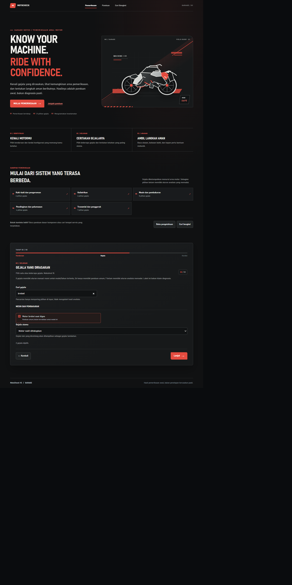
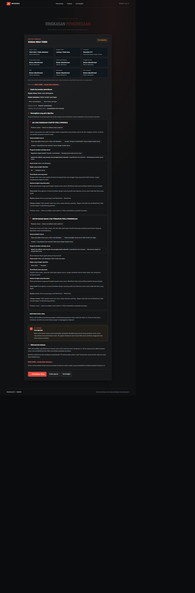
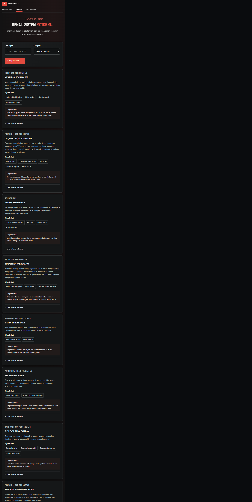
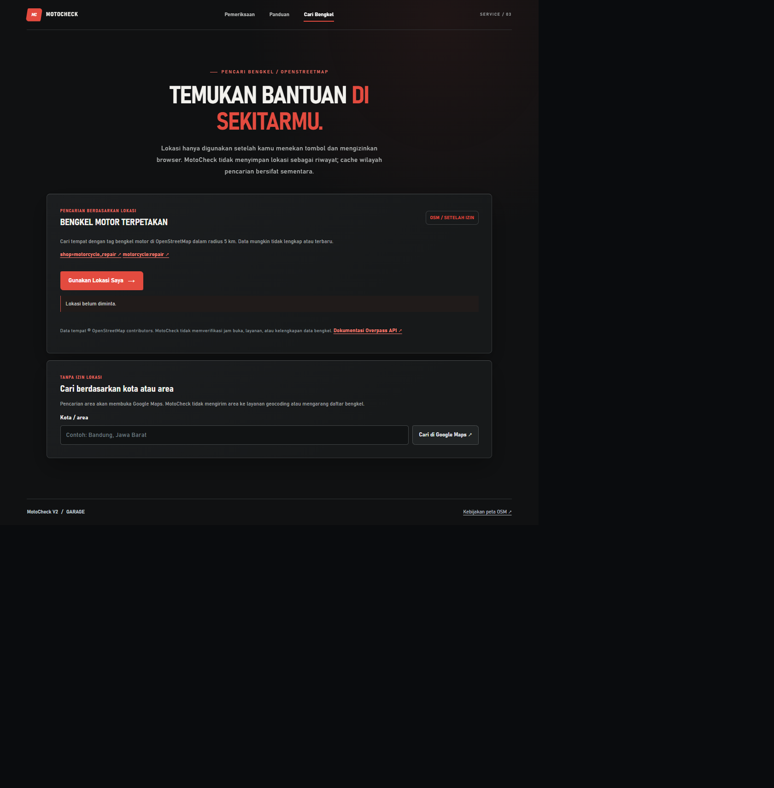

# 🏍️ MotoCheck

**Web-Based Motorcycle Diagnosis and Troubleshooting Application**

MotoCheck is a web-based motorcycle diagnosis and troubleshooting application built with **Python and Flask**. The project provides a structured interface for exploring motorcycle-related symptoms, accessing technical knowledge, and viewing diagnosis results.

---

## 📌 Overview

MotoCheck is developed as a software project focused on motorcycle diagnosis and troubleshooting.

The application combines a Flask backend with a web interface built using HTML, CSS, and JavaScript. Its source code is organized into separate modules for diagnosis, knowledge management, catalog data, and workshop-related functionality.

## ✨ Features

The project includes the following application areas:

- **Motorcycle Diagnosis** — Diagnosis-related functionality organized in dedicated Python modules.
- **Guided Interface** — Vehicle and symptom-related interface supported by an interactive JavaScript wizard.
- **Diagnosis Results** — A dedicated page for displaying diagnosis results.
- **Knowledge Base** — Motorcycle-related knowledge and reference data.
- **Workshop Information** — A dedicated section for workshop-related information.
- **Responsive Interface** — Desktop and mobile interface screenshots are included in the project.

*Note: The exact diagnosis rules and available data depend on the current implementation.*

## 🖥️ Screenshots

### Home Page


### Home Page — Mobile



### Vehicle Selection



### Symptom Selection



### Diagnosis Result



### Knowledge Base



### Workshop Information



---

## 🛠️ Tech Stack

| Technology | Purpose |
|---|---|
| Python | Backend programming |
| Flask | Web application framework |
| HTML | Web page structure |
| CSS | Interface styling |
| JavaScript | Frontend interactions |
| JSON | Structured application data |

## 📂 Project Structure

```text
MotoCheck/
│
├── motocheck/
│   ├── data/
│   │   ├── knowledge.json
│   │   ├── rules.json
│   │   ├── sources.json
│   │   ├── symptoms.json
│   │   └── vehicles.json
│   │
│   ├── __init__.py
│   ├── catalog.py
│   ├── diagnosis.py
│   ├── knowledge.py
│   └── workshops.py
│
├── screenshots/
│
├── static/
│   ├── css/
│   │   └── style.css
│   ├── images/
│   │   └── garage-bike.svg
│   └── js/
│       ├── wizard.js
│       └── workshops.js
│
├── templates/
│   ├── hasil.html
│   ├── index.html
│   ├── knowledge.html
│   └── workshops.html
│
├── tests/
│   └── test_app.py
│
├── app.py
├── requirements.txt
├── PANDUAN_BELAJAR_PRESENTASI.md
└── .gitignore
```

## ⚙️ Installation and Setup

Follow these steps to run MotoCheck locally.

### 1. Clone the repository

```bash
git clone https://github.com/alippiu/MotoCheck.git
```

### 2. Navigate to the project directory

```bash
cd MotoCheck
```

### 3. Create a virtual environment

```bash
python -m venv .venv
```

### 4. Activate the virtual environment

**Windows PowerShell:**

```powershell
.venv\Scripts\Activate.ps1
```

**Windows Command Prompt:**

```cmd
.venv\Scripts\activate.bat
```

### 5. Install dependencies

```bash
pip install -r requirements.txt
```

### 6. Run the application

```bash
python app.py
```

Open the local address displayed in your terminal to access the application.

## 🧪 Testing

The project includes a test directory containing application tests.

To run the tests, use:

```bash
pytest
```

Make sure the project dependencies are installed before running the tests.

## 📚 Documentation

Additional project documentation is available in:

`PANDUAN_BELAJAR_PRESENTASI.md`

## 👨‍💻 Developer

**Alif Radinka**

GitHub: [@alippiu](https://github.com/alippiu)

Repository: [MotoCheck](https://github.com/alippiu/MotoCheck)

---

## 📄 License

No license has been specified for this repository yet.

---

<p align="center">
  <strong>MotoCheck</strong><br>
  Motorcycle Diagnosis and Troubleshooting Application
</p>